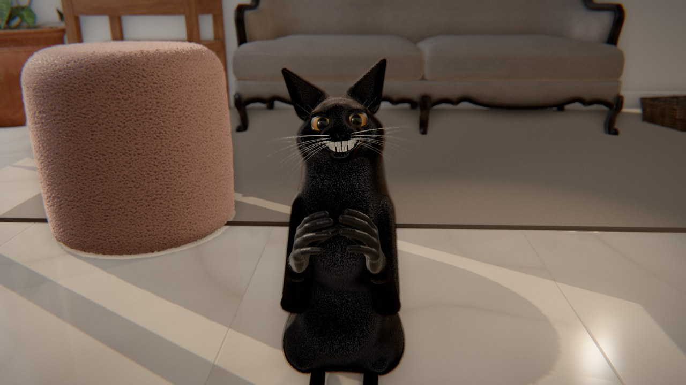

# 拍手する黒猫 3D — Black Cat Clapping (three.js)



2026年9月にバズった AI 動画ミーム **「Black Cat Clapping（拍手する黒猫）」** を、
**家の中（リビング）を舞台にしたリアルタイム 3D アニメーション**として再現したプロジェクトです。

おやつをもらった黒猫が立ち上がり、**人間の歯でニヤッと笑い**、**人間の手でゆっくり拍手**し、
口を押さえてクスクス笑い、最後にスマホ（撮影者）に向かって**握手を求めて手を差し出す**――
という元動画の流れを、手続き的に作った黒猫モデル・毛皮シェーダー・IK リグ・物理ベースの室内ライティングで描いています。
ネオン調の演出は使わず、昼の自然光が差し込む落ち着いた室内（クリーム色の大理石タイル床、ピンクのテディ素材のプーフ、ソファ、観葉植物）にしています。

- **スマホ横画面・全画面での再生を前提**にしています（再生ボタンで全画面化＋横向きロック）。
- 画質の初期設定は **MAX**（解像度 DPR 最大 3、毛皮シェル 64 層）。端末が重い場合だけ自動で ULTRA（DPR 2、48 層）に切り替わります。
- 書き出し済みの動画: `media/black-cat-clapping.mp4`（1920×1080 / 60fps / 音声付き）

---

## 見かた

### スマホ（推奨）
**公開ページ: https://claude.ai/artifact/TdPQyAzW67UxvQmzbb9oqp**（約 46 MB を読み込みます。Wi-Fi 推奨）

1. ページを開いて ▶ をタップ → 全画面・横向きで再生が始まります。
2. 画面をタップすると下に操作バーが出ます。

| ボタン | 機能 |
| --- | --- |
| ↺ | 最初から再生 |
| ⏸ / ▶ | 一時停止 / 再開 |
| シークバー | 好きな位置へ移動 |
| `1×` | 再生速度 1× → 0.5× → 0.25×（スロー再生で拍手や表情をじっくり見られます） |
| `POV` | カメラ切り替え: **POV**（元動画と同じスマホ目線）→ **シネマ**（ゆっくり回り込むカメラ）→ **フリー**（ドラッグで回転・ピンチでズーム） |
| `MAX` | 画質 MAX ⇄ ULTRA |
| 🔊 | サウンド オン/オフ |
| ⛶ | 全画面の切り替え |

> **iPhone の場合**: Safari は Web ページの全画面 API に対応していないため、共有メニューから
> **「ホーム画面に追加」**して、ホーム画面のアイコンから開くと全画面で表示できます（横向きにしてください）。

### PC / ローカルで動かす
```bash
npm install
npm run build        # dist/app.js を生成（esbuild）
npm run dev          # http://127.0.0.1:5173/ で配信（ファイル変更を自動ビルド）
```
`index.html` はビルド済みの `dist/app.js` を読み込みます。`file://` では読み込めないので、必ず HTTP サーバー経由で開いてください。

公開ページ用のフォルダは `node tools/build-artifact.mjs` で `build/artifact/` に作られます
（ホスティング先が一般的な Web 形式しか配信しないため、`.bin` / `.hdr` は base64 テキストにして同梱し、
`src/assets.js` が読み込み時に元のバイナリへ戻します）。

---

## ミームについて（調査まとめ）

| 項目 | 内容 |
| --- | --- |
| 名称 | Black Cat Clapping / Cat Clapping Meme（拍手する黒猫） |
| 初出 | 2026年9月25日、Instagram の **@merkurianin**（Aleksandr Kim）が投稿した約10秒の AI 生成動画 |
| 内容 | 男性が黒猫におやつをあげる → 猫が後ろ足で立ち上がる → **人間のような歯を見せてニヤッと笑う** → **人間の手で、ゆっくり大きな音で拍手** → 口を手で押さえて笑う → 男性に握手を求めて手を差し出す（男性は真顔） |
| 拡散 | 投稿から1週間ほどで 250 万以上の「いいね」。TikTok ではグリーンバック素材として広まり、@asian5767（9/28、約380万回再生）、@mis2027seniors（9/30、約170万回再生、「正解したらこいつが拍手しだした」）、@yeltiktok（10/1、約150万回再生）など。音源は「original sound – Green Screen Memes」 |
| 使われ方 | **皮肉っぽい拍手**（「はいはい、よくできました」「お見事（棒読み）」）のリアクションとして使われることが多い |
| 派生 | クレイアニメ版（@fajnyczlowiek01）、シンプソンズ風（@lorenzodagosto）、ウマ娘のゴールドシップ版（@aidelchannel2）、『猫の恩返し』版（@aguxx_edit13）など |

再現にあたって重視したポイント:
- 黒猫・人間の歯のニヤけ顔・人間の手での**ゆっくりした拍手**（指を少し交差させて叩く）・口を押さえる仕草・握手の差し出し
- 撮影者目線（スマホを持った人がおやつを差し出す手が画面に入る）
- 床はクリーム色の光沢タイル、左奥にピンクのテディ素材のプーフ

参考にした情報源:
- Know Your Meme — Black Cat Clapping: https://knowyourmeme.com/memes/black-cat-clapping
- meme.com — Black Cat Clapping: https://meme.com/memes/black-cat-clapping
- Verge Magazine — Memes explained: Black Cat Clapping: https://vergemagazine.co.uk/memes-explained-black-cat-clapping
- popcreep.com の解説記事、Creatorset のグリーンバック素材ページ、YouTube Shorts（z-94wlZQXvg）

---

## 技術的な中身

すべて自前のコードで作っています（3D モデルの猫は外部素材を使わず、プログラムで生成）。

**猫のモデル（`tools/gen-cat.mjs`, `tools/cat/*`）**
- 解剖学的な形状を SDF（符号付き距離関数）のプリミティブの滑らかな合成で「彫刻」し、
  疎ブロックの Surface Nets → ニュートン法で等値面へ投影 → meshoptimizer で減数化（約 20 万ポリゴン）
- 骨格（背骨・首・頭・耳・腕・人間の指 15 本×2・後ろ足・しっぽ 8 節）と、プリミティブ距離からの自動スキンウェイト
- 毛の長さ・毛流れ（コーム方向）・SDF からのアンビエントオクルージョンを頂点属性として焼き込み
- 笑顔のモーフ（口の奥の暗がり＋口角の持ち上がり）、別メッシュの唇と歯（1本ずつ形・傾き・色が少しずつ違う）、ひげ

**レンダリング（`src/cat/materials.js` ほか）**
- 毛皮: 最大 64 層のシェル法（インスタンス描画）＋ 3D ウォーリー・ノイズの毛束、alpha-to-coverage + MSAA、
  Kajiya-Kay の2ローブ異方性スペキュラ、逆光の透過、重力によるたわみ
- 目: 角膜での屈折を計算する虹彩シェーダー（縦長の瞳孔、クリアコート）、まぶたのまばたき・笑い目
- 室内: Poly Haven（CC0）の家具・テクスチャ・HDRI、窓からの太陽光（影付き）＋窓の面光源、
  床の鏡面反射（斜めクリップ付きプレーナーリフレクション）、部屋から作った環境マップ（IBL）
- ポストプロセス: GTAO（環境遮蔽）、被写界深度、ブルーム、トーンカーブ・ビネット・フィルムグレイン

**アニメーション（`src/anim/*`）**
- キーフレーム（Catmull-Rom 補間＋到着側イージング）で振り付けし、腕と足は 2 ボーン IK、手の位置は
  ルート/胸/頭の座標系をブレンドして指定（口を押さえる手が頭に追従するなど）
- 呼吸・しっぽの揺れ・耳のピクッ・まばたき・カメラ目線・おやつへの視線などの手続き的な二次モーション
- スマホ撮影らしい手ブレカメラ（POV）、元動画と同じ上から見下ろす構図 → しゃがみ込む動き

**サウンド（`src/audio.js`）**
- 拍手・かじる音・咀嚼音・風切り音を WebAudio で手続き生成し、合成した室内残響を付けています（音源ファイル不使用）

---

## 動画の書き出し

ヘッドレス Chromium（SwiftShader）でフレームを1枚ずつ描画し、手続き生成した効果音と合わせて MP4 にします。
途中で止めても、もう一度同じコマンドを実行すれば続きから再開できます（CPU 描画なので 1 フレーム約 25 秒、全 804 フレームで約 5〜6 時間）。

```bash
node tools/render-video.mjs --w 1920 --h 1080 --fps 60 --shells 48 \
  --frames-dir frames/final --out media/black-cat-clapping.mp4 --encode
```
`--encode` を付けると、最後に `tools/render-audio.mjs` で効果音（WAV）を作り、ffmpeg で
H.264（CRF 15）+ AAC の MP4 にまとめます（冒頭 0.3 秒のフェードイン、最後 0.4 秒のフェードアウト付き）。

## ディレクトリ構成

```
index.html            プレイヤー（スタート画面・操作バー）
src/                  実行時コード（three.js r170）
  player.js           横画面・全画面プレイヤー、画質・カメラ切り替え
  app/sequence.js     ミームのシーン全体（猫・人の手・おやつ・カメラ）
  anim/               振り付け（memeChoreo.js）、キーフレーム、コントローラー（IK）
  cat/                猫の読み込み・リグ・マテリアル（毛皮・目・歯）
  scene/              部屋・床反射・プーフ・人の手・ポストプロセス
  audio.js            手続き的サウンド
tools/                オフライン生成（猫・人の手・床テクスチャ）、ビルド、動画書き出し
assets/               生成済みモデル（cat.bin / human.bin）、Poly Haven 素材
```

## クレジット

- 元ネタのミーム動画: @merkurianin（Instagram）。本プロジェクトはファンによる再現作品で、元動画の映像・音声は一切使用していません。
- 3D 素材・テクスチャ・HDRI: [Poly Haven](https://polyhaven.com)（CC0）。一覧は `assets/ph/CREDITS.md`
- 3D エンジン: [three.js](https://threejs.org)（MIT）
